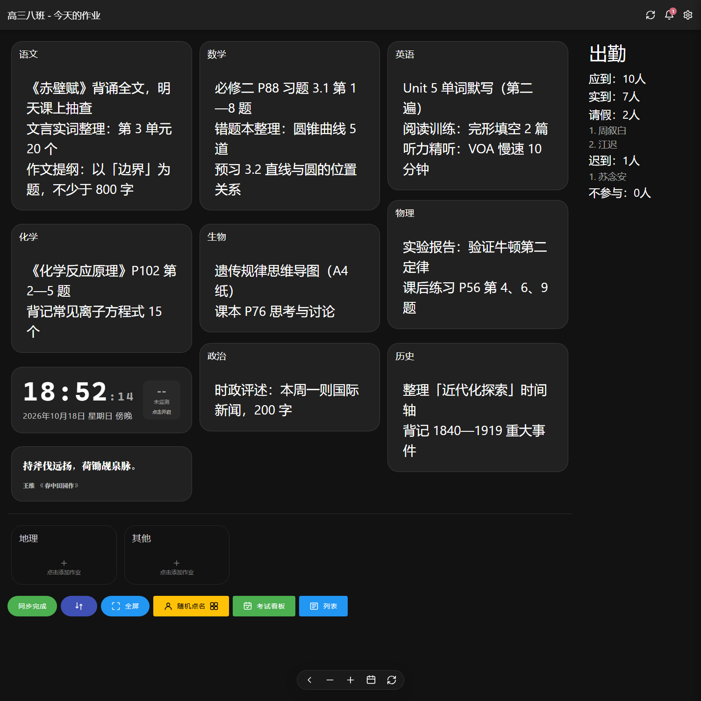

# ClassworksLite

适用于班级大屏的作业板，**为 Serverless 部署重写**。

ClassworksLite 保留了 [Classworks](https://github.com/Moonrend/Classworks) 的界面语言与全部核心交互
（文案、Material 3 视觉、作业卡片、出勤、考试看板、设置项均与上游一致），
把原先需要常驻 Express + PostgreSQL + Socket.IO 的后端压缩成**一个 KV 函数**，
前端是纯静态产物，可直接跑在 Cloudflare Pages、Cloudflare Workers 或 Vercel 上。

- 零配置启动：默认本地模式（浏览器存储），打开即用
- 一个函数即可联网：`GET/PUT/DELETE /api/kv`，约 200 行，无框架依赖
- 离线可用：PWA 缓存 + 离线写入队列，断网照常记录，恢复后自动补传
- 单文件数据模型：每天一条 KV 记录，兼容上游键名
- 新特性：**UAF 作业导入导出**、**环境噪音监测**（晚自习时段自动记录与统计报告）、**密码保护的管理后台**（全站数据 / 日志 / 备份）



> 站内标题、PWA 名称、浏览器标签均标识为 **ClassworksLite**；与上游同名的设置项文案保持原样，
> 便于对照官方文档。

---

## 与 Classworks 的功能对照

### 已实现（行为对齐）

| 能力 | 说明 |
| --- | --- |
| 作业板瀑布流 | 3 / 2 / 1 列自适应 masonry，鼠标跟随高光、内容更新发光提示 |
| 作业编辑 | 换行即分条、自动保存（停顿 2 秒）、粘贴 / 粘贴并完成、数字快捷键盘、常用字 |
| 空科目处理 | 卡片 / 按钮 / 移动端 chip 三种形态，随 `display.emptySubjectDisplay` 切换 |
| 出勤统计 | 应到 / 实到 / 请假 / 迟到 / 不参与，桌面侧栏 + 移动端卡片，迟到可计入出勤 |
| 学生名单 | 逐条增删、批量编辑（支持从 Excel 整列粘贴、自动去序号） |
| 科目管理 | 增删改、上下移动、顺序即卡片顺序 |
| 时间卡片 | 时钟 + 日期 + 时段，点开全屏时钟，附带倒计时与秒表 |
| 一言卡片 | 在线接口 + 内置句子兜底，可配置刷新间隔 |
| 随机点名 | 按姓名 / 学号抽取，支持排除请假、迟到、不参与，带滚动动画 |
| 考试看板 | 多科目多日期安排、考场信息、固定到作业板作为卡片 |
| 日期导航 | 前一天 / 后一天 / 日期选择器 / 回到今天 / 把作业复制到今天 |
| 历史保护 | 禁止自动保存非当天、保存需确认、禁止编辑历史数据 |
| 列表视图 | 一屏纵览全部科目 + 打印 |
| 消息记录 | 顶栏铃铛 + 右侧抽屉，保留最近 100 条操作消息与类型图标 |
| UAF 导入导出 | 选择日期 → 勾选作业 → 生成 PDF 预览 / 导出；导入 PDF 后按日期分组、冲突项可选保留或覆盖 |
| 环境噪音监测 | 实时分贝、等级、评分与波形；晚自习时段自动记录并生成统计报告；支持自动 / 手动校准 |
| 管理后台 | 密码登录后查看全站数据概况、搜索 / 编辑 / 删除 / 新建任意数据键、导出全站备份，并查看写入与登录审计日志 |
| 主题与排版 | 深色 / 浅色、正文字号 16–100px、自定义背景（模糊 + 遮罩） |
| 防烧屏提示 | 可选展示 |
| PWA | manifest + Service Worker，可安装、离线打开 |

### 有意替换

| 上游 | 本项目 | 原因 |
| --- | --- | --- |
| Classworks KV / 设备令牌 / OAuth | 本地模式 / 云端模式 + 访问密码、编辑令牌（旧版 `SITE_TOKEN` 仍兼容） | Serverless 无常驻会话，两级静态凭证即可满足单班级「查看 / 编辑」分离 |
| Socket.IO 实时推送 | 15 秒增量轮询 + `BroadcastChannel`（同浏览器多标签即时） | 长连接需要常驻进程或 Durable Objects；轮询对作业板场景足够 |
| PostgreSQL + Prisma | KV / Redis 键值存储 | 数据模型本来就是「按日期一条 JSON」，无需关系库 |
| 设备聊天、紧急通知、消息日志 | 未实现 | 依赖常驻服务端推送 / 账号体系，与 Serverless 单班级目标无关 |

> 数据键名保持与上游一致（`classworks-data-YYYYMMDD` 等），把上游数据导出成
> 同样的 JSON 后可以直接读到本项目的云端存储里。

---

## UAF 导入导出

UAF（Unified Assignment Format）是上游定义的可携带样式与正文的作业 PDF 格式。
ClassworksLite 复用了上游的浏览器端生成/解析包（`src/vendor/uaf/browser.js`）与
HarmonyOS Sans SC 字体，导出结果与上游一致。

- **导出**：选择日期 → 系统列出当天可导出的作业 → 勾选 → 右侧实时预览 PDF →
  可调整标题 / 正文 / 标签的字号与字重 → 「导出所选作业」。
  文件名格式：`Classworks-作业-YYYY-MM-DD.uaf.pdf`。
- **导入**：选择内嵌 `uaf_payload.csv` 的 UAF PDF → 解析后按日期分组 →
  逐项选择「导入 / 跳过」；同名卡片默认「保留现有」，也可改为「覆盖现有」。
- 导入按日期合并写回 `classworks-data-YYYYMMDD`，离线时自动进入补传队列。
- 首次导出会下载约 24 MB 字体与 0.6 MB WASM（`public/uaf/`），建议开启 CDN 缓存。

入口：作业板底部工具栏的 ⇅ 按钮（受 `display.showUafTransfer` 控制）。

## 环境噪音监测

使用 Web Audio API 在本地采集麦克风时域数据（RMS），换算为显示分贝；
音频不录音、不上传，仅在浏览器内存中计算。

- 时间卡片右侧实时显示分贝与等级（极其安静 → 极度嘈杂），点击打开详情。
- 详情包含「实时监测 / 统计报告」两个标签：
  - 实时：分贝仪表、0–100 dB 色带、走势图、综合评分与「持续 / 时长 / 打断」扣分明细。
  - 报告：按日期归档的统计报告，含时长、均分、峰值、超阈时长、打断次数、走势与等级分布。
- 晚自习时段（设置 → 噪音监测）进入区间自动开始、离开区间自动归档；
  时段与报警阈值保存在 `noise-session-config`（KV），跨设备共享。
- 校准：在已知环境分贝下做 3 秒自动校准，或手动填写基准分贝 / 基准 RMS / 最大分贝。
- 相关设置：`noiseMonitor.enabled`、`noiseMonitor.autoStart`、`noiseMonitor.permissionDismissed`。

## 访问密码与编辑权限

服务端支持两级访问控制，均由 `/api/auth` 与 `/api/kv` 联合校验，前端无法绕过：

| 环境变量 | 作用 | 前端操作 |
| --- | --- | --- |
| `SITE_PASSWORD` | 打开网站时要求输入访问密码，通过后签发 7 天有效的 HMAC 访问令牌，用于读取作业 | 访问门自动弹出，输入一次即可 |
| `EDIT_TOKEN` | 修改 / 删除作业时要求 `X-Edit-Token`，未配置则不限制写入 | 「设置 → 服务器 → 访问权限 → 编辑令牌」填写同值 |
| `AUTH_SECRET` | 访问令牌签名密钥；修改后所有访客的访问状态立即失效 | — |
| `SITE_TOKEN` | 旧版静态访问令牌，仍可作为访问凭证（Bearer / `X-Site-Key`） | 「设置 → 服务器 → 网站令牌」 |

行为说明：

- 访问令牌保存在浏览器 localStorage，过期后自动回到访问门；「访问权限」卡片可手动
  退出访问、重新校验。
- 编辑令牌只保存在本地设置（localStorage），仅在 PUT / DELETE 请求时作为
  `X-Edit-Token` 发送，不会随 GET 请求暴露。
- 只配置 `SITE_PASSWORD` 时，任何访客都能查看并编辑；只配置 `EDIT_TOKEN` 时不设
  查看密码，但修改仍需令牌。
- 未配置编辑令牌或令牌无效时，前端进入只读模式：编辑操作被拦截并提示，不会产生
  失败的写入请求或离线队列。
- 同一 IP 连续 5 次访问密码错误锁定 10 分钟，限流状态保存在保留键 `__access-guard`；
  登录、失败与越权请求都会写入审计日志。
- 旧部署没有 `/api/auth` 时，前端自动视为「未启用访问控制」，保持原有行为。

```bash
# 本地体验
SITE_PASSWORD=class-password EDIT_TOKEN=teacher-token npm run dev
```

---

## 管理后台

入口：页面底部「设置 → 服务器 → 管理后台」，或直接访问 `/admin`。

管理后台默认禁用，必须在部署平台配置 `ADMIN_PASSWORD`；未配置时 `/api/admin`
返回 503 `admin_not_configured`。可选配置 `ADMIN_SECRET` 作为令牌签名密钥
（修改后所有已登录会话立即失效）。

| 环境变量 | 必填 | 说明 |
| --- | --- | --- |
| `ADMIN_PASSWORD` | 是 | 管理后台登录密码，建议使用 16 位以上随机字符串 |
| `ADMIN_SECRET` | 否 | 令牌 HMAC 签名密钥；留空时使用 `ADMIN_PASSWORD` |

功能：

- **概览**：数据键数量、占用空间、近 24 小时更新数、最近写入时间；按前缀归类
  （作业数据 / 花名册 / 科目 / 考试 / 作业模板 / 噪音时段 / 其他）统计键数与大小。
- **数据**：搜索、分组筛选、分页浏览全部数据键；查看与编辑任意 JSON 值、
  新建数据键、删除数据键；保存时带乐观并发校验，数据被其他设备修改会提示冲突。
- **日志**：记录管理员登录 / 登录失败 / 写入 / 删除 / 清空日志，以及站点通过
  `/api/kv` 的写入、删除和令牌校验失败；支持按来源与关键字过滤。日志最多保留
  最近 500 条。
- **备份**：一键导出全部数据（`{ 键名: { value, updatedAt } }` 的 JSON 文件），
  数据键超过 1000 条或总大小超过 8 MB 时拒绝导出。

安全设计：

- 登录成功后签发 HMAC-SHA256 令牌（格式 `v1.<expiresAt>.<nonce>.<signature>`），
  有效期 12 小时；令牌保存在 `sessionStorage`，关闭标签页即退出，不写入 localStorage。
- 密码比较与签名校验均为常量时间；同一 IP 连续 5 次密码错误锁定 10 分钟，
  限流状态保存在保留键 `__admin-guard`。
- 所有 `__` 前缀的键（日志、限流状态）对公开 `/api/kv` 完全不可见、不可读写；
  后台数据列表也会过滤这些键。
- 管理接口只记录写操作与登录事件，不记录读请求，避免放大 KV 读写次数。
- 日志写入失败不会阻断数据写入（审计失败只打印警告）。

> 管理后台复用 `/api/kv` 的同一份 KV 数据，部署时不需要额外数据库。
> 管理密码只保存在服务端环境变量中，前端不会内置任何默认密码。

---

## 二次开发

设置页「首页」内置同样的说明，代码入口如下：

| 想改什么 | 入口 |
| --- | --- |
| 页面与组件 | `src/pages`、`src/components` |
| 设置项（键名 / 默认值 / 分组 / 标题） | `src/lib/settings.ts` |
| 主题与组件样式 | `src/index.css`（`--v-theme-*` 令牌） |
| 数据与同步 | `src/lib/store.ts`、`src/lib/kv.ts` |
| 访问门与访问状态 | `src/components/AccessGate.tsx`、`src/lib/access.ts` |
| 管理后台前端 | `src/pages/Admin.tsx`、`src/lib/admin.ts` |
| 访问 / 管理接口 | `server/auth-core.ts`、`server/admin-core.ts`、`server/token.ts`、`server/audit.ts` |
| 服务端 | `server/kv-core.ts` + `functions` / `worker` / `api` 适配器 |
| UAF 导入导出 | `src/lib/uafExport.ts` |
| 环境噪音监测 | `src/lib/noise.ts` |

品牌名称统一写作 **ClassworksLite**（站点标题、PWA manifest、README、NOTICE）。
对外分发修改版时请保留 `LICENSE` 与 `NOTICE.md`，并按 AGPL-3.0 提供对应源码。

## 技术栈

| 层 | 选型 |
| --- | --- |
| 前端 | React 19 + TypeScript 5 + Vite 7 |
| 样式 | Tailwind CSS 4 + 自建 Material 3 / Vuetify 风格令牌（无 UI 组件库） |
| 状态 | 外部 store + `useSyncExternalStore`，零状态库 |
| 本地存储 | `localStorage`（同步读写，首屏零等待） |
| 云端存储 | Cloudflare KV / Upstash Redis，经统一 `Backend` 接口 |
| 图标 | 内联 SVG 图标集，无图标字体 |
| 文档导出 | UAF 浏览器 bundle + HarmonyOS Sans SC 字体子集 |
| 构建产物 | 单页静态资源，gzip 后约 150 KB（不含 UAF 字体） |

---

## 快速开始

```bash
npm install
npm run dev          # http://localhost:3031
```

打开后可直接在卡片上填写作业；想先看完整版面，访问 `/?demo=1` 载入示例作业，
或用 `/?edit=语文` 直接打开某一科的编辑框。

`npm run dev` 自带一个本地 KV 服务（`server/dev-kv-plugin.ts`），把 `/api/kv`
落到 `.data/kv.json`。因此在设置里切到「云端同步」也能在本地完整跑通读写与离线队列，
不需要提前部署后端。

管理后台在本地同样可用：在仓库根目录的 `.env.local` 写入 `ADMIN_PASSWORD=你的密码`，
或直接运行 `ADMIN_PASSWORD=你的密码 npm run dev`，然后访问
`http://localhost:3031/admin`。

访问密码与编辑令牌同理，写入 `.env.local` 或直接通过命令行传入：

```bash
SITE_PASSWORD=class-password EDIT_TOKEN=teacher-token npm run dev
```

配置 `SITE_PASSWORD` 后刷新页面即可看到访问门；编辑令牌在「设置 → 服务器 → 访问权限」填写。
纯静态部署（没有 `/api/auth`）会自动跳过访问门。

其他命令：

```bash
npm run typecheck    # tsc --noEmit
npm run build        # 产物输出到 dist/
npm run preview      # 预览构建结果（同样带本地 KV）
```

---

## 部署

### 方案一：Cloudflare Pages（推荐）

静态资源走 CDN，`/api/kv` 由 Pages Functions 提供。

1. 创建 KV 命名空间：

   ```bash
   npx wrangler kv namespace create KV
   ```

2. Cloudflare 控制台 → Pages → 你的项目 → **设置 → 绑定 → KV 命名空间**
   - 变量名：`KV`
   - 命名空间：上一步创建的命名空间

3. 构建设置：
   - 构建命令：`npm run build`
   - 输出目录：`dist`

4. （可选）环境变量：
   - `SITE_PASSWORD`：启用访问密码，访客输入后才能查看作业
   - `EDIT_TOKEN`：启用编辑令牌，修改作业需在设置中填写同值
   - `AUTH_SECRET`：访问令牌签名密钥（可选，推荐单独设置）
   - `SITE_TOKEN`：旧版静态访问令牌（可选，迁移期兼容）
   - `CORS_ORIGIN`：限制允许来源，默认 `*`
   - `ADMIN_PASSWORD`：启用管理后台（必需，否则 `/admin` 不可用）
   - `ADMIN_SECRET`：管理令牌签名密钥（可选，推荐单独设置）

部署后访问 `/api/health` 应返回 `{"ok":true,...}`。

### 方案二：Cloudflare Workers（静态资源 + API 一体）

```bash
npx wrangler kv namespace create KV      # 把返回的 id 填进 wrangler.toml
npm run build
npx wrangler deploy
```

`wrangler.toml` 已配置 `[assets]`，Worker 只接管 `/api/*`，其余交给静态资源。
敏感值用 `npx wrangler secret put` 写入：

```bash
npx wrangler secret put SITE_PASSWORD    # 访问密码（查看作业前登录）
npx wrangler secret put EDIT_TOKEN       # 编辑令牌（修改作业时校验）
npx wrangler secret put AUTH_SECRET      # 可选，访问令牌签名
npx wrangler secret put SITE_TOKEN       # 可选，旧版静态令牌
npx wrangler secret put ADMIN_PASSWORD   # 管理后台必需
npx wrangler secret put ADMIN_SECRET     # 可选
```

本地 `wrangler dev` 时把同样的值写进 `.dev.vars`（格式 `KEY=value`）。

### 方案三：Vercel（Upstash Redis）

1. 在 Upstash 创建 Redis 数据库，拿到 REST URL 与 TOKEN
2. Vercel 项目环境变量：
   - `UPSTASH_REDIS_REST_URL`
   - `UPSTASH_REDIS_REST_TOKEN`
   - 访问控制：`SITE_PASSWORD`、`EDIT_TOKEN`、`AUTH_SECRET`（均可选）
   - 旧版兼容：`SITE_TOKEN`；跨域：`CORS_ORIGIN`
   - 管理后台：`ADMIN_PASSWORD`（必需）、`ADMIN_SECRET`（可选）
3. 直接导入仓库，`vercel.json` 已配置构建与 SPA 重写

### 方案四：纯静态（本地模式）

`npm run build` 后把 `dist/` 丢到任意静态托管即可。没有 `/api/kv` 时，
应用会停留在本地模式，数据只存在当前浏览器。

> 多台设备需要共享数据时，才需要云端模式。
> 使用 UAF 导出 / 噪音监测均为浏览器端能力，纯静态部署同样可用。

---

## 数据模型

每天一条记录，键名与上游一致：

```
classworks-data-20261018      → { homework: {...}, attendance: {...} }
classworks-list-main          → [{ "name": "陈亦舟" }, ...]
classworks-config-subject     → [{ "name": "语文", "order": 0 }, ...]
classworks-exams              → [{ id, examName, subjects: [...], ... }]
classworks-config-homework-template → 作业模板（可选）
noise-session-config          → { sessions: [{ name, start, duration, enabled }], alertThresholdDb }
```

单日作业结构：

```json
{
  "homework": {
    "语文": { "content": "背诵《赤壁赋》\n练习册 P32-35" },
    "custom-1712345678901": { "name": "自定义卡片", "content": "值日：第三组", "type": "custom" },
    "exam-1712345678901": { "type": "exam", "examId": "1712345678901", "content": "" }
  },
  "attendance": { "absent": ["周叙白"], "late": [], "exclude": [] }
}
```

噪音评分与报告只存本机（`localStorage`：`classworks-noise-reports`、
`classworks-noise-calibration`），不进入共享数据。

内部保留键（`__` 前缀，公开 `/api/kv` 不可访问）：

```
__admin-logs                  → 最近 500 条审计日志（新→旧）
__admin-guard                 → 管理登录失败限流状态（按 IP 哈希）
__access-guard                → 访问密码失败限流状态（按 IP 哈希）
```

## API 契约

```
GET    /api/auth           → 200 { passwordRequired, editRequired, authenticated, editAuthenticated }
POST   /api/auth           → body { action: "login", password } → 200 { token, expiresAt, ... } | 401 / 429
GET    /api/kv?key=K       → 200 { key, value, updatedAt } | 404 { error: "not_found" }
GET    /api/kv?prefix=P    → 200 { keys: [{ key, updatedAt }] }
PUT    /api/kv             → body { key, value } → 200 { key, updatedAt }
DELETE /api/kv?key=K       → 200 { ok: true }
GET    /api/health         → 200 { ok: true, service: "classworks-lite-kv", ts }
POST   /api/admin          → body { action, ... } → 200 { ... } | 400 / 401 / 409 / 413 / 429 / 503
```

- 查看鉴权：配置 `SITE_PASSWORD` 时，`/api/kv` 需要
  `Authorization: Bearer <登录返回的令牌>`（7 天有效）；未配置时回退到
  `Authorization: Bearer <SITE_TOKEN>` 或 `X-Site-Key: <SITE_TOKEN>`，都未配置则跳过
- 编辑鉴权：配置 `EDIT_TOKEN` 时，`PUT` / `DELETE` 还需要
  `X-Edit-Token: <EDIT_TOKEN>`，缺失或错误返回 403 `edit_token_required`
- `/api/auth` 登录成功返回 HMAC-SHA256 令牌（`v1.<expiresAt>.<nonce>.<signature>`），
  同一 IP 连续 5 次密码错误返回 429，锁定 10 分钟
- 管理接口：除 `login` 外的动作都需要 `Authorization: Bearer <adminToken>`
  （或 `X-Admin-Token`），令牌由 `login` 返回
- 单条上限 1 MB，键长上限 200 字符
- `__` 前缀为内部保留键（`__admin-logs`、`__admin-guard`），公开接口不可读写，
  也不会出现在 `prefix` 查询与管理后台的数据列表中
- 所有响应 `Cache-Control: no-store`

管理接口动作：

| action | 参数 | 说明 |
| --- | --- | --- |
| `login` | `password` | 校验密码，返回 `{ token, expiresAt }`（12 小时） |
| `session` | — | 校验令牌，返回 `{ authenticated, expiresAt, logLimit }` |
| `stats` | — | 数据键总数、总大小、近 24 小时更新数与分组统计 |
| `keys` | — | 全部数据键的 `{ key, updatedAt, size, group }`（最多 1000 条） |
| `get` | `key` | 读取单条数据，返回 `{ key, value, updatedAt, size, legacy, group }` |
| `put` | `key`, `value`, `baseUpdatedAt?` | 写入；新建时 `baseUpdatedAt` 省略且键不能已存在，修改时用于并发校验 |
| `delete` | `key`, `baseUpdatedAt?` | 删除；带 `baseUpdatedAt` 时校验是否被改动 |
| `logs` | — | 最近 500 条审计日志 |
| `backup` | — | 导出全部数据（超过 1000 条或 8 MB 时返回 413） |
| `clear_logs` | — | 清空审计日志，并记录一条 `clear_logs` 事件 |

---

## 目录结构

```
├── src/
│   ├── components/          卡片、对话框、基础控件
│   │   ├── AccessGate.tsx   全屏访问密码门
│   │   ├── NoiseMonitorDetail.tsx   噪音详情（实时 / 报告 / 校准）
│   │   ├── UafTransferDialog.tsx    UAF 导入导出对话框
│   │   └── settings/               设置卡片、设置项、噪音设置、访问权限
│   ├── pages/               作业板 / 设置 / 列表 / 考试看板 / 管理后台
│   ├── lib/
│   │   ├── store.ts         全局数据中心（作业、出勤、名单、同步）
│   │   ├── kv.ts            本地 / 云端客户端，含离线队列
│   │   ├── access.ts        访问令牌、访问状态与编辑令牌
│   │   ├── admin.ts         管理接口客户端（登录、数据、日志、备份）
│   │   ├── noise.ts         噪音采集、评分、校准与报告存储
│   │   ├── uafExport.ts     UAF 校验、预览、导入计划与落盘
│   │   ├── settings.ts      设置项定义与校验
│   │   └── hooks.ts         useAppState / useSetting / useMasonry
│   ├── vendor/uaf/          上游 UAF 浏览器 bundle
│   └── index.css            Material 3 / Vuetify 风格设计令牌
├── public/
│   ├── uaf/                 UAF 字体与 hb-subset.wasm
│   └── manifest.webmanifest PWA 清单（名称为 ClassworksLite）
├── server/
│   ├── kv-core.ts           与平台无关的 KV 处理器
│   ├── auth-core.ts         访问密码 / 编辑令牌校验（/api/auth）
│   ├── token.ts             HMAC 令牌签发与常量时间校验
│   ├── login-guard.ts       登录失败限流（管理后台与访问密码共用）
│   ├── admin-core.ts        管理接口（登录、数据管理、备份）
│   ├── audit.ts             审计日志与客户端信息提取
│   ├── cloudflare.ts        Cloudflare KV 适配（Worker / Pages 共用）
│   ├── upstash.ts           Upstash Redis 适配
│   └── dev-kv-plugin.ts     本地开发用 KV + 访问 / 管理接口（.data/kv.json）
├── functions/api/kv.ts      Cloudflare Pages Function
├── functions/api/auth.ts    Cloudflare Pages 访问接口
├── functions/api/admin.ts   Cloudflare Pages 管理 Function
├── worker/index.ts          Cloudflare Workers 入口
├── api/kv.ts                Vercel Edge Function
├── api/auth.ts              Vercel Edge 访问接口
└── api/admin.ts             Vercel Edge 管理 Function
```

---

## 设计说明

**为什么用 localStorage 而不是 IndexedDB。**
作业板的数据量是「每天几 KB」，localStorage 的 5 MB 足够存放数年；同步读写让首屏
不必等待异步回调，也避免了无痕模式、无头浏览器下 IndexedDB 打开挂起的问题。
写入超配额时会自动淘汰最旧记录后重试。

**为什么保留 15 秒轮询。**
Serverless 没有常驻连接，Socket.IO 不可用。作业板的更新频率是「一天几十次」，
轮询成本可以忽略；同浏览器的多标签用 `BroadcastChannel` 做到即时。轮询只在
云端模式、页面可见、且没有未保存改动时执行。

**为什么设置项不进云端。**
主题、字号、布局偏好是「这台设备」的属性，班级大屏和手机不应该互相覆盖。
作业、名单、科目、考试、晚自习时段才是共享数据。

**为什么噪音报告只存本机。**
分贝曲线是细粒度时序数据，单次晚自习可达上千点；放进 KV 会迅速放大存储与同步成本。
报告按日期保留最近 40 条，足够回看；需要长期归档时再用 UAF 或截图导出。

**离线优先。**
云端模式下所有读取先读本地缓存（命中时先渲染），再等网络结果覆盖；写入失败会
标记 `pending`，`online` 事件触发时自动补传。界面顶部的状态会如实反映同步情况。

---

## 许可

AGPL-3.0，与上游保持一致。见 `LICENSE` 与 `NOTICE.md`。

界面文案、UAF 工具链与部分交互逻辑来自 [Moonrend/Classworks](https://github.com/Moonrend/Classworks)，
版权归原作者所有。
